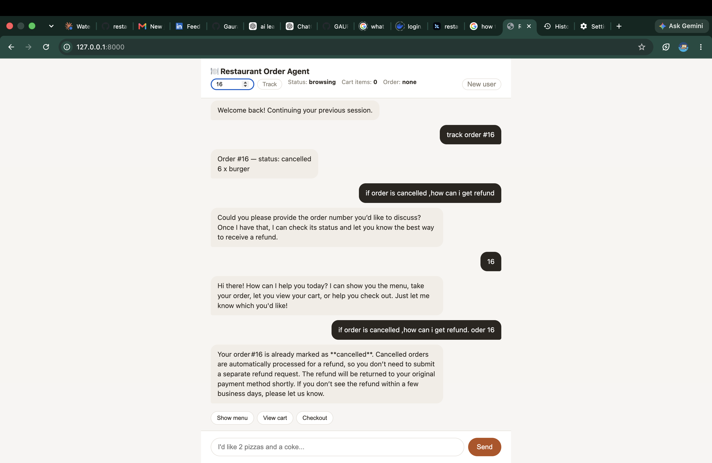
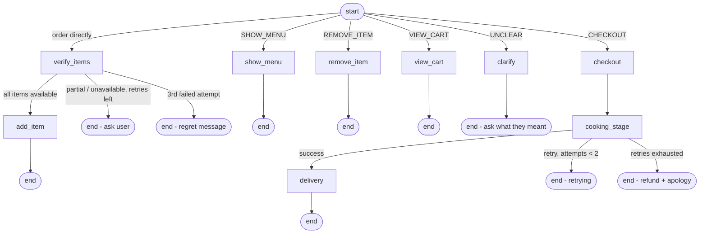

# restaurant-order-agent

[](https://github.com/Gauravkr07/restaurant-order-agent/actions/workflows/ci.yml)

A LangGraph-based restaurant ordering agent, exposed as a FastAPI service.

## Demo



*Screenshot of the browser chat UI (`static/index.html`) mid-conversation — showing the menu, cart, and status bar.*

> Drop a screenshot of the running UI at the repo root as `demo.png` for it to render above. See [Run](#run) for how to start the app and grab one.

## Structure

The app is layered so each concern has one home: HTTP in `api/`, agent
behavior in `agents/`, graph wiring in `graph/`, data access in `domain/`,
and cross-cutting setup in `core/`.

```
app/
  main.py                  FastAPI app: static files, routers, exception handlers
  api/
    routes/chat.py         POST /chat - the conversational endpoint
    routes/orders.py       order tracking, idempotent checkout, refund approval
    routes/menu.py         GET /menu
    schemas.py             request/response models
    errors.py              every exception handler, in one place
  agents/
    cart_agent.py          tool-calling agents for adding/removing cart items
    order_agent.py         tool-calling agent for existing orders (status/refund/cancel)
    runtime.py             shared tool loop, structured-output retries, reply composition
    prompts.py             every system prompt, in one place
    schemas.py             structured LLM outputs (RequestedItem, AddItemVerdict, ...)
  graph/
    builder.py             StateGraph wiring only
    nodes.py               one function per conversation step
    state.py               State + Status enum
  core/
    config.py              all env vars, typed and validated at boot
    guardrails.py          prompt-injection filter + untrusted-input notice
    llm.py                 the shared ChatGroq client
    logging.py             structured JSON logging
  domain/
    models.py              SQLAlchemy models
    repository.py          data access (see Data layer)
    session_store.py       per-turn session counters in Redis
    seed.py                menu seed script
  tools/
    menu.py cart.py order.py   LangChain tools the agents call
  tasks/                   Celery post-checkout fan-out
```

Supporting directories:

- `alembic/` — database migrations.
- `static/index.html` — a minimal browser chat UI for `/chat` (plain HTML/JS, no build step). Its Checkout button calls `POST /checkout` directly (not a chat message), generating and reusing an `Idempotency-Key` per cart so a double-click can't create two orders — see [Endpoints](#endpoints).
- `tests/` — pytest suite covering the graph nodes (see [Testing](#testing)).
- `eval/` — scenario suite run against the real LLM (see [Evaluation](#evaluation)).
- `demo.png` — screenshot of the UI, shown at the top of this README (not committed by default — add your own).
- `Dockerfile` / `docker-compose.yml` — containerized app + Postgres + Redis (see [Run with Docker](#run-with-docker)).
- `.env.example` — copy to `.env` and fill in your `GROQ_API_KEY` (and optionally `DATABASE_URL`, `REDIS_URL`, `LANGSMITH_*`).

## Setup

Requires Postgres (source of truth — see [Data layer](#data-layer)) and Redis (session counters):

```bash
brew install postgresql@16 redis   # macOS; see postgresql.org/redis.io for other platforms
brew services start postgresql@16
brew services start redis
createuser restaurant -P   # password: restaurant
createdb restaurant_order_agent -O restaurant
```

Then the app itself:

```bash
python3 -m venv .venv
source .venv/bin/activate
pip install -r requirements.txt
cp .env.example .env   # then edit .env with your real GROQ_API_KEY
alembic upgrade head
python -m app.domain.seed
```

## Run

```bash
uvicorn app.main:app --reload
```

Service runs at http://localhost:8000:

- **http://localhost:8000/** — browser chat UI (fastest way to try the agent)
- **http://localhost:8000/docs** — interactive API docs (Swagger)

### Run with Docker

A `docker-compose.yml` runs the app, Postgres, and Redis together — no local Postgres/Redis install needed:

```bash
cp .env.example .env   # then edit .env with your real GROQ_API_KEY
docker compose up --build
```

This starts three containers:

- `postgres` — a `postgres:16-alpine` container, persisted via a named volume (`postgres-data`), exposed on host port **5433** (not 5432, to avoid clashing with a local Postgres install).
- `redis` — a `redis:7-alpine` container, persisted via a named volume (`redis-data`).
- `app` — the FastAPI service, built from the `Dockerfile`. On start it runs `alembic upgrade head` then `python -m app.domain.seed` automatically, then starts `uvicorn`. Connects to both over Docker's internal network (`postgres:5432`, `redis:6379` — service names, not `localhost`).

`docker-compose.yml` reads `GROQ_API_KEY` from your `.env` file in the same directory. The app container waits for both `postgres` and `redis` to report healthy before starting.

Same URLs as running locally: http://localhost:8000/ for the chat UI, http://localhost:8000/docs for the API docs.

To stop: `docker compose down` (add `-v` to also delete the Redis volume and its stored sessions).

## Conversation flow

The customer can either browse the menu first or order directly — both paths converge on the same verification step before anything is added to the cart.



Key rules baked into the graph:

- **Verification, not blind add**: an order-style message always goes through `verify_items` first. Items are only added to the cart once stock is confirmed.
- **3-strike limit**: `query_count` tracks failed verification attempts. On the 3rd unresolved attempt the agent sends a regret message and stops (`status = "regretted"`).
- **Cart merge, not replace**: `add_item` sums quantities into an existing cart line for the same item instead of overwriting it.
- **Stock is reserved at checkout, not at add-to-cart**: placing an order decrements `menu_items.stock` in the same transaction that creates the order, via a conditional `UPDATE ... WHERE stock >= quantity` per line. If any line can't be satisfied the whole order is refused (`OutOfStockError`) and nothing is written — so two people racing for the last pizza can't both get it, and stock never goes negative. The customer is told exactly what ran out and that nothing was charged.
- **Refunds require delivery**: a customer can only be refunded for an order that actually reached them (`status = "delivered"`). An order still in `ordered` is cancelled instead, never refunded — refunding it would pay out for food that may still be served. The one exception is the kitchen's own failure path, which calls `request_refund(order_id, kitchen_failure=True)` because the customer paid and got nothing.
- **Cooking retries**: `cooking_stage` simulates kitchen failures, retries up to 2 times (`cook_retry_count`), and if still failing apologizes and flags a refund instead of retrying forever.
- **Stateful turns, server-side**: the graph is not one-shot. `status`, `query_count`, `cook_retry_count`, `cart`, and `order` all live in a Redis-backed session, keyed by `session_id`. The client never sees or sends these — it only ever sends a `message` (and the `session_id` after the first call).
- **Ask, don't guess**: `route_intent` doesn't silently force ambiguous input into one of the known actions. See [Routing: classifier vs. agentic](#routing-classifier-vs-agentic) below.

## Routing: classifier vs. agentic

`route_intent` already used the LLM to classify each message — it was never a fixed keyword matcher. But the original version forced every message into one of 5 labels and, when the model's answer didn't match any of them, silently defaulted to `SHOW_MENU`. That's a classifier with a blind guess bolted on: it never admits uncertainty, it just picks something and hopes.

The current version adds a 6th label, `UNCLEAR`, with explicit instructions not to force-fit ambiguous input into a real action. When the model reaches for `UNCLEAR`, the graph routes to a `clarify` node instead of guessing — it asks the customer what they meant and lists what it can actually help with (menu, order, cart, checkout). Try it: "what time do you close tonight?" gets a clarifying question, not a menu dump.

**3-strike limit on off-topic messages**: `unclear_count` tracks *consecutive* unclear messages (any on-topic action resets it to 0). After 3 in a row, the agent sends a polite closing message, sets `status = "regretted"`, and the session is closed — any further message to that `session_id` gets rejected with `409 Conversation has ended`. This mirrors the same 3-strike pattern already used for `query_count` (failed verification) and `cook_retry_count` (cooking failures): the agent doesn't loop forever on something that isn't working, it apologizes and stops.

This is the difference between a *classifier* (always outputs one of N fixed labels, even when none fit) and something closer to *agentic* behavior (recognizes the limits of its own understanding and asks rather than acting on a guess). It's a small change — one new label, one new node — but it changes what the system does when it doesn't know, which is where a lot of real agent failures come from.

## Data layer

**PostgreSQL is the source of truth** for menu, sessions, carts, and orders — not Redis. Architecture: `FastAPI → LangGraph → db/repository.py ("Tools") → PostgreSQL`.

- `app/domain/models.py` — SQLAlchemy models for 6 tables: `menu_items`, `sessions`, `carts`, `cart_items`, `orders`, `order_items`. (`restaurants`/`users`/`payments`/`agent_runs` were considered and deliberately left out — see `prompt_implementation.md`'s dated instructions for why.)
- `app/domain/repository.py` — the only place that talks to Postgres. Each function opens its own short session, does one unit of work, commits. the graph's nodes call these as plain functions (e.g. `repository.add_cart_item(session_id, "pizza", 2)`), never touching SQL directly.
- `alembic/` — migrations. `alembic upgrade head` applies them; runs automatically on container start (see `Dockerfile`).
- `app/domain/seed.py` — seeds `menu_items` with the starter menu (`python -m app.domain.seed`); safe to re-run.
- Cart merge-not-replace, one-cart-per-session, etc. are enforced by DB constraints (`uq_cart_item`, unique `carts.session_id`), not just application logic — see the initial migration in `alembic/versions/`.
- `checkout` snapshots each line's price into `order_items.price_at_order`, so a later menu price change never rewrites history.

**Redis** now only holds per-turn session counters (`status`, `query_count`, `cook_retry_count`, `unclear_count`, `turn_count`) — cache/session-scoped, not the source of truth for anything durable. Keys still auto-expire after 24h of inactivity (`SESSION_TTL_SECONDS`, see `app/core/config.py`).

`LangGraph`'s own state-update mechanism (`State`, returned from each node, merged by the graph) is unchanged and still how nodes communicate *within* one `/chat` call — `State` just no longer carries `cart`/`order` copies, only `session_id`, `order_id`, and the routing/counter fields, since the durable data lives in Postgres and is fetched fresh via the repository whenever a node needs it.

## Debugging & tracing (LangSmith)

By default there's no visibility into what the graph actually did on a given turn — which node ran, how long each LLM call took, how many tokens it used, or where an error came from. [LangSmith](https://smith.langchain.com) (LangChain's own tracing platform) plugs into that gap with basically no code changes, since the agent is already built with `langchain-core`/`langgraph`, both of which know how to emit traces to it automatically.

To turn it on, add these to `.env` (see `.env.example`):

```bash
LANGSMITH_TRACING=true
LANGSMITH_API_KEY=your_langsmith_api_key_here
LANGSMITH_PROJECT=restaurant-order-agent
```

Get a free API key at [smith.langchain.com](https://smith.langchain.com). With tracing on, every `/chat` request produces a full trace in the LangSmith dashboard showing:

- **Workflow**: the exact sequence of nodes the graph ran for that message (`route_intent → verify_items → add_item`, etc.) as a visual tree.
- **Latency**: how long each node and each individual LLM call took, so a slow turn can be traced to the specific step causing it.
- **Token usage**: prompt/completion tokens per LLM call, and totals per request.
- **Errors**: if a node raises (a Groq flake, an unexpected state), the trace shows exactly which step failed and with what exception, instead of just a log line.

Leaving `LANGSMITH_TRACING` unset (or `false`) disables tracing entirely — the app behaves exactly the same either way, this is purely additive observability, not a dependency the app needs to run.

## Logging

The app logs structured JSON lines to stdout (`app/core/logging.py`) — no log files to manage, since `docker compose logs` (or any container log driver) already captures and retains stdout. Each line is one JSON object, e.g.:

```json
{"timestamp": "2026-09-30T04:07:49+0000", "level": "INFO", "logger": "agent", "message": "route_intent_decision", "session_id": "8e85fbe9-...", "intent": "ADD_ITEM", "route": "VERIFY_ITEMS"}
```

What's logged:

- **Every graph node execution** (`node_show_menu`, `node_verify_items`, `node_add_item`, etc.) and the routing decisions `route_intent` makes, with the classified intent and the node it routed to.
- **Guardrail events**: prompt injection attempts caught (`prompt_injection_detected`), extraction retries and failures, session closures (3-strike unclear limit, verify-attempt limit, cooking failures, turn-count limit).
- **Request-level timing**: `chat_request`/`chat_response` in `app/api/routes/chat.py` log message length in, final status and total duration (`duration_ms`) out.
- **Errors**: every Groq exception handler and the LLM-failure fallback path log with a full traceback (`exc_info=True`), and validation errors log the specific field(s) that failed.

Every log line emitted while handling a `/chat` request — whether from the HTTP layer or from a graph node — automatically carries the same `session_id`, via a `contextvars.ContextVar` set once per request (see `current_session_id` in `app/core/logging.py`). This makes it possible to filter logs down to one customer's entire conversation without threading a session id through every function signature.

Set `LOG_LEVEL` in `.env` to control verbosity (defaults to `INFO`; use `DEBUG` for more detail, `WARNING` to quiet things down).

## Testing

The test suite covers the graph's node functions directly — the LLM is replaced with a fake (`tests/conftest.py`'s `FakeLLM`) so tests run offline, deterministically, and in well under a second. No *real* Groq API key or running Redis server is required — `conftest.py` sets a harmless placeholder key so `ChatGroq` can construct itself, but no real request is ever made.

```bash
pip install -r requirements-dev.txt
pytest
```

What's covered (see `prompt_testcase.md` for the full spec this suite was built from):

- **Verification / retry / regret**: full availability → cart; partial availability → asks the user and increments `query_count`; 3rd failed attempt → regret message (`test_verify_items.py`).
- **Cart merge**: adding more of an item already in the cart sums the quantity instead of replacing it (`test_add_item.py`).
- **Cart removal**: partial removal, full removal, over-removal, and removing an item not in the cart (`test_remove_item.py`).
- **Stock reservation** (`test_stock.py`): checkout decrements stock, an order larger than stock is refused with the shortfall reported, a refused order leaves stock untouched, and the last unit can't be sold twice.
- **Refund rules** (`test_refund_rules.py`): only delivered orders are customer-refundable, the kitchen-failure path may still refund an undelivered order, and already-resolved orders are never refundable again.
- **Checkout → cooking → delivery**: order creation, the cooking success/retry/regret-with-refund paths (with `random.random` monkeypatched for determinism), and delivery marking the order delivered (`test_checkout_cooking_delivery.py`).
- **Routing**: `ADD_ITEM` → `VERIFY_ITEMS` remap, `UNCLEAR`/unparseable model output → `CLARIFY` (not a silent `SHOW_MENU` guess), and the `cooking_retry` short-circuit that skips LLM classification entirely (`test_route_intent.py`).
- **3-strike session close**: consecutive unclear messages incrementing `unclear_count`, and the 3rd one closing the session (`test_clarify.py`).
- **Flaky-extraction retry**: `extract_requested_items` retrying once on a `groq.GroqError` and raising once retries are exhausted (`test_extract_requested_items.py`).

## Evaluation

`eval/` measures actual LLM behavior against real Groq calls (not mocked — see [Testing](#testing) for the offline correctness suite). A scoped-down eval set (not the originally-discussed 100+ scenarios — see `prompt_implementation.md`'s dated notes) covering intent classification, clarification, task completion, and prompt injection:

```bash
python -m eval.run_eval
```

Requires `DATABASE_URL` and a real `GROQ_API_KEY`. Runs each scenario through the real graph, reports per-scenario pass/fail plus aggregate metrics (intent accuracy, task completion rate, clarification rate, latency, token usage), and writes full results to `eval/last_run.json`. This suite already caught one real bug: `checkout` on an empty cart still unconditionally fell through to `cooking_stage`/`delivery`, so the model would confirm a "delivered" order that was never actually created — fixed via a `route_after_checkout` conditional edge that only proceeds to cooking when `checkout` actually set an `order_id`.

## CI/CD

`.github/workflows/ci.yml` runs on GitHub Actions with two jobs:

- **`test`** — on every push (any branch) and every pull request targeting `main`: installs `requirements-dev.txt` and runs the full `pytest` suite. No Groq API key or Redis instance needed, since the suite is fully offline (see [Testing](#testing)) — `tests/conftest.py` sets a dummy `GROQ_API_KEY` before the app is imported, since `ChatGroq`'s constructor requires *some* key to be present even though the fake LLM used in tests never makes a real call.
- **`publish`** — only after `test` passes, and only on a direct push to `main` (`needs: test` + a branch/event condition, so a broken build can never be published): builds the Docker image and pushes it to GitHub Container Registry as `ghcr.io/gauravkr07/restaurant-order-agent:latest` and `:<commit-sha>` (the repository name is lowercased in its own step, since Docker tags reject uppercase). Uses the automatic `GITHUB_TOKEN` GitHub provides to every workflow run — no extra secrets or accounts to set up.

This covers CI (automated testing on every change) and CD up through "produce a deployable, versioned image" — it does not deploy that image anywhere yet, since that depends on where you eventually host the app (a VPS, a cloud container service, etc.), which is a separate decision.

Pulling and running the published image directly (once it's public, or after `docker login ghcr.io` if kept private):

```bash
docker run -p 8000:8000 \
  -e GROQ_API_KEY=your_groq_api_key_here \
  -e REDIS_URL=redis://host.docker.internal:6379/0 \
  ghcr.io/gauravkr07/restaurant-order-agent:latest
```

(Still needs a reachable Redis — see [Run with Docker](#run-with-docker) for the full `docker-compose.yml` setup that includes one.)

## Endpoints

- `GET /` — chat UI (`static/index.html`)
- `GET /menu` — list menu items
- `POST /chat` — send a message. Omit `session_id` on the first call:

  ```json
  {
    "message": "show me the menu"
  }
  ```

  The response includes a `session_id` — pass it back on every following call so the agent resumes where the customer left off:

  ```json
  {
    "message": "I want 2 pizzas",
    "session_id": "4522e886-...-..."
  }
  ```

  Response shape: `session_id`, `reply`, `status`, `cart`, `order`, `cooking_duration` (set once cooking has started). An unrecognized `session_id` returns `404`; a `session_id` whose conversation has ended (`status = "regretted"`) returns `409` — start a new session (omit `session_id`) to order again.

- `POST /checkout` — idempotent checkout, separate from the chat flow. Requires an `Idempotency-Key` header:

  ```bash
  curl -X POST http://localhost:8000/checkout \
    -H "Idempotency-Key: <client-generated-key>" \
    -d '{"session_id": "..."}'
  ```

  Calling this more than once with the **same key** (e.g. three rapid "PAY" clicks) returns the **same order** every time (`created: false` on repeats) instead of creating duplicates — enforced by a UNIQUE `idempotency_key` column, a `SELECT ... FOR UPDATE` row lock on the cart, and a Redis distributed lock. On a genuinely new order, a Celery task fans out four follow-up actions in parallel (`send_confirmation`, `notify_restaurant`, `generate_invoice`, `update_delivery_status` — currently stubs, no real integrations yet); replays never re-trigger these. Requires the `celery-worker` service (`docker compose up` starts it automatically). The chat UI's Checkout button calls this endpoint directly (see `static/index.html`), not `/chat`.

- `GET /orders/{order_id}` — public order tracking by order number (no auth — same as the rest of this app). Returns `{order_id, status, items}`, `404` if the order doesn't exist. The chat UI has a "Track order" box that calls this directly.

- `POST /orders/{order_id}/approve-refund` / `POST /orders/{order_id}/reject-refund` — resolve a refund parked at `pending_refund_approval` (order total over ₹100 — see [Data layer](#data-layer)). No admin UI yet; call these directly. `404` if the order isn't currently awaiting approval.

A refund is only possible on a **delivered** order; asking for a refund on an order that hasn't arrived yet gets it cancelled instead (see [Conversation flow](#conversation-flow)).

Customers can also ask about an existing order **conversationally** through `/chat` — "what's the status of order 16?", "I'd like a refund for order 17", "cancel order 16" all route to a tool-calling flow (`get_order_status` / `request_refund_for_order` / `cancel_order`) rather than a fixed endpoint call, same pattern as ordering/cart management.

## Deploying (Render + Neon)

[`render.yaml`](render.yaml) is a Render Blueprint describing the whole deployment: the FastAPI web service, the Celery worker, and Redis. **Postgres is not in it** — this setup uses [Neon](https://neon.tech) as an external managed Postgres, so the database outlives any single deploy and can be branched for staging.

### 1. Create the Neon database

Create a project in Neon, then copy the connection string for the **pooled** endpoint (its host contains `-pooler`). Keep the `sslmode=require` parameter — Neon refuses unencrypted connections.

The scheme Neon gives you (`postgresql://`) is rewritten to `postgresql+psycopg://` automatically in [`app/core/config.py`](app/core/config.py), because SQLAlchemy only picks psycopg 3 when the scheme says so and would otherwise reach for the uninstalled psycopg2. So paste the string exactly as Neon shows it.

### 2. Deploy the blueprint

Push the repo to GitHub, then in Render choose **New > Blueprint** and select it. Render reads `render.yaml` and creates all three services. It will prompt for the two secrets marked `sync: false`, which are never committed:

| Secret | Where to get it |
| --- | --- |
| `DATABASE_URL` | The Neon pooled connection string from step 1 |
| `GROQ_API_KEY` | <https://console.groq.com/keys> |

`REDIS_URL` is wired automatically from the Redis service in the blueprint. Set `region` in `render.yaml` to whichever Render region is closest to your Neon region — every request makes several database round-trips, so this is the cheapest latency win available.

### 3. Verify

```bash
curl https://<your-service>.onrender.com/healthz   # {"status":"ok"}
curl https://<your-service>.onrender.com/readyz    # checks Postgres + Redis
curl https://<your-service>.onrender.com/menu      # the seeded menu
```

Then open the service URL in a browser for the chat UI.

### How the deploy is wired

- **Migrations run once per deploy**, not once per replica, via `preDeployCommand` (`alembic upgrade head && python -m app.domain.seed`). Both commands are safe to re-run: Alembic skips applied revisions and the seed leaves existing menu items alone.
- **`$PORT` is honoured.** Render injects the port to bind; the Dockerfile defaults it to 8000 so `docker compose up` still works unchanged.
- **Two health endpoints, deliberately different.** `/healthz` touches nothing external, so a transient Redis blip can't make Render pull a healthy instance out of rotation. `/readyz` checks Postgres and Redis and returns `503` naming whichever is down — use it when diagnosing.
- **Connection pools are small** (`DB_POOL_SIZE`, `DB_MAX_OVERFLOW`) because the web service and the worker each hold their own and share Neon's connection budget. `pool_pre_ping` plus `pool_recycle` handle Neon closing idle connections, so the first request after a quiet spell doesn't fail.
- **Redis over TLS.** Render's connection string uses `rediss://`; Celery needs an explicit SSL config for that scheme or it won't connect. Certificates are verified — if a provider uses a CA outside the container's trust store, point `REDIS_SSL_CA_CERTS` at its bundle rather than disabling verification.
- **The worker runs `--pool=solo`**, which suits a starter instance and avoids prefork's fork-safety issues (the same crash seen on macOS locally). Scale by adding instances, or move to `--pool=prefork --concurrency=N` on a larger plan.

### Notes and limits

- **Neon can drop a connection mid-query.** A suspended or recycled Neon compute surfaces as `psycopg.OperationalError: SSL error: unexpected eof while reading`. `pool_pre_ping` catches the common case (a connection that went stale while idle in the pool), but it cannot catch a connection that dies *during* a query. Deploying in the same region as the Neon project makes this rare; if you see it in production, the fix is a retry around the repository call, not a pool setting.
- **Starter instances sleep when idle.** The first request after a sleep pays both Render's cold start and, if the Neon branch has also suspended, its wake-up — expect a slow first reply, then normal latency.
- **Sessions live in Redis with a 24h TTL.** Redis here is a cache, not a system of record: if it's wiped, in-flight conversations reset, but carts and orders are safe in Neon.
- **The refund-approval endpoints are unauthenticated.** `POST /orders/{id}/approve-refund` and `/reject-refund` are open to anyone who can reach the service, which is fine for a local demo and **not** fine on a public URL. Put auth in front of them before sharing the link.

## Roadmap

- Payment integration (not yet implemented)
- HTTP-layer tests for `app/api/` (session lifecycle, 404/409 handling) — the current suite tests the graph nodes directly
